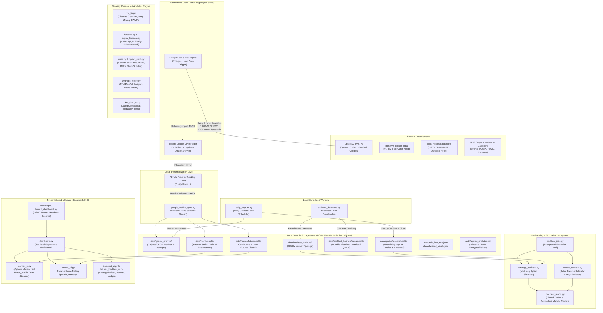
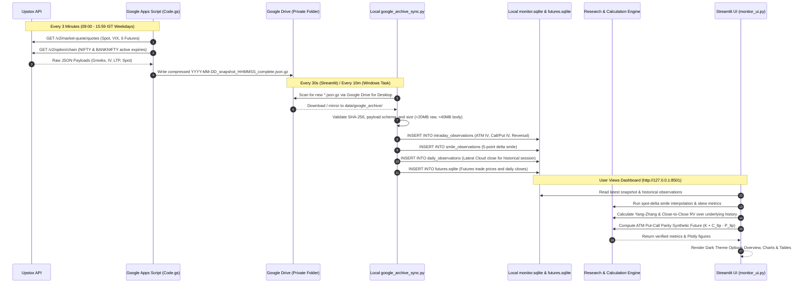

# Volatility Lab — Comprehensive Technical Audit & System Architecture Report

**Audit Date:** November 3, 2026  
**Auditor / Role:** Lead Engineering and Research Agent  
**Target Repository:** `D:\My First Algo`  
**Application Root:** `D:\My First Algo\Volatility Lab`  
**Operating Environment:** Windows 10/11 x64, Isolated Sandboxed Execution, Standalone Embedded Python 3.12.5 Runtime  
**Audit Status:** Read-Only Complete — Zero project files modified, zero external transactions triggered, zero credentials exposed.

---

## Table of Contents
1. [Executive Summary](#1-executive-summary)
2. [Project Architecture Diagram](#2-project-architecture-diagram)
3. [End-to-End Data-Flow Architecture](#3-end-to-end-data-flow-architecture)
4. [Complete Project Folder & Module Inventory](#4-complete-project-folder--module-inventory)
5. [Development Environment & Dependency Manifest](#5-development-environment--dependency-manifest)
6. [External Integrations, APIs & Infrastructure](#6-external-integrations-apis--infrastructure)
7. [Git & Version Control Status](#7-git--version-control-status)
8. [Volatility Research Engine Audit](#8-volatility-research-engine-audit)
9. [Strategy & Backtesting Engine Audit](#9-strategy--backtesting-engine-audit)
10. [Dashboard & User Interface Architecture](#10-dashboard--user-interface-architecture)
11. [Component Operational Status Matrix](#11-component-operational-status-matrix)
12. [Known Issues, Data Anomalies & Technical Risks](#12-known-issues-data-anomalies--technical-risks)
13. [Prioritized Engineering & Research Roadmap](#13-prioritized-engineering--research-roadmap)
14. [Open Questions Requiring User Clarification](#14-open-questions-requiring-user-clarification)

---

## 1. Executive Summary

### 1.1 What Volatility Lab Is
**Volatility Lab** is a specialized, institutional-grade quantitative volatility research, market monitoring, and strategy backtesting workstation focused exclusively on Indian equity index derivatives (**NIFTY 50** and **NIFTY BANK** listed on the National Stock Exchange of India, NSE).

The project is designed with a strict **local-first, privacy-first, zero-broker-orders** philosophy. It connects to the Upstox market data API strictly in read-only mode, using Windows DPAPI-encrypted authentication tokens. The lab is completely decoupled from order placement, live execution, or capital-at-risk brokerage endpoints.

### 1.2 Core Capabilities
1. **Autonomous 24/7 Cloud Data Collection**:
   - Google Apps Script (`cloud/apps_script/Code.gs`) runs 100% serverless on Google infrastructure, capturing 3-minute intraday option chains, underlying spot quotes, India VIX, and active futures contracts during NSE trading hours (09:00–15:59 IST weekdays).
   - EOD session collection runs 18:00–22:00 IST with automated morning reconciliation (07:00–09:00 IST) for missing daily candles.
   - Gzipped snapshots are archived into a private Google Drive folder, synced locally to `data/google_archive` via Google Drive for Desktop, and ingested into local SQLite datastores.
2. **Massive Historical Minute & EOD Derivatives Archive**:
   - **Options 1-Minute Historical Candle Archive**: Over **235.79 million 1-minute rows** (119,916 completed API batch jobs) covering historical index option contracts across both NIFTY and BANKNIFTY.
   - **Dated Futures Archive**: 54 index futures contracts with full daily OHLC/OI history and rolling carry matrices.
   - **Research Datastore**: 130.9 MB SQLite store (`data/upstox/research.sqlite`) housing multi-year index daily and 1-minute benchmark candles.
3. **Rigorous Volatility Research Engine**:
   - **Implied Volatility (IV)**: Arithmetic mean of Upstox broker-supplied ATM Call IV and Put IV. Strict policy (`IV DATA POLICY.md`) forbids synthetic backfilling or model-derived IV reconstruction.
   - **Realized Volatility (RV)**: Close-to-Close historical volatility (HV10, HV30) and multi-component Yang-Zhang (2000) overnight/intraday jump-adjusted volatility.
   - **Conditional Volatility & Forecasting**: Zero-mean recursive EWMA ($\lambda=0.94$), analytic multi-step GARCH(1,1) via `arch` with student-t innovations, and trading-session-weighted expiry variance matching.
   - **Surface & Skew Diagnostics**: 5-point spot-delta smile (10P, 25P, ATM, 25C, 10C), Risk Reversal ($RR_{25}$), Butterfly ($BF_{25}$), and ATM Put-Call Parity Synthetic Futures ($K + C_{ltp} - P_{ltp}$) comparison against listed futures LTP.
4. **Execution-Realistic Multi-Leg Backtesting Engine**:
   - Supports multi-leg option strategies (Straddles, Strangles, Iron Condors, Butterflies, Vertical Spreads) and Futures calendar carry spreads.
   - **Strict Execution Realism**: Minute-close signal generation with guaranteed execution fill at the **next minute's open** ($t+1$ bar Open).
   - **Regulatory Fee Modeling**: Exact regulatory fee schedules (STT post-Oct 2024 Budget hike, NSE/IPFT transaction fees, SEBI turnover fees, Stamp duty on buys, 18% GST, and configurable per-order brokerage).
   - **Mark-to-Market & Incomplete Position Tracking**: Unresolved positions at expiry boundaries are quarantined and reported separately without corrupting realized trade statistics.
5. **Desktop Dashboard**:
   - Streamlit 1.64.0 application served locally at `http://127.0.0.1:8501`, wrapped by a Win32 native named event launcher (`desktop.py`), non-blocking background threads, dark financial UI, and automated data revision caching.

### 1.3 Operational Health & Current State (November 3, 2026)
- **Drive Mirror Sync**: **Active and Healthy**. Latest capture ingested at 11:11:03 IST today (`2026-11-03_snapshot_110942_complete.json.gz`), 1,482 total archives synced with zero errors.
- **Laptop Daily Collector**: **Active**. Successfully ran `history_catchup` today at 10:11–10:12 IST, refreshing 2,788 instruments in `master.json`.
- **Historical 1-Minute Downloader**: **Completed Available Requests** on October 27, 2026 at 21:35 IST (235,796,830 candle rows; queue state: `finished_available_requests`).
- **Free Disk Headroom**: Drive `D:\` has **84.36 GB free** of 105.80 GB (adequate for ongoing operations).

---

## 2. Project Architecture Diagram



---

## 3. End-to-End Data-Flow Architecture



---

## 4. Complete Project Folder & Module Inventory

The root directory contains two primary working directories and top-level Windows execution scripts:
- `D:\My First Algo\START HERE.md`: Operational handover, quick-start guide, and data catalog.
- `D:\My First Algo\Open Dashboard.cmd`: Launches `desktop.py` using `.runtime\pythonw.exe`.
- `D:\My First Algo\Turn Off Dashboard.cmd`: Signals graceful shutdown to `desktop.py --stop`.
- `D:\My First Algo\Documentation\`: Architectural decisions, change logs, and screenshots.
- `D:\My First Algo\Volatility Lab\`: Core production codebase, data storage, and bundled runtime.

### 4.1 Root and Documentation Inventory

| Path | Purpose | Key Content / Details |
| :--- | :--- | :--- |
| `START HERE.md` | Top-level system overview and daily operations manual | Documents launchers, schedule details, folder inventory, and deduplication records. |
| `Open Dashboard.cmd` | Windows launcher batch script | Executes `Volatility Lab\.runtime\pythonw.exe desktop.py`. |
| `Turn Off Dashboard.cmd` | Windows stop batch script | Executes `Volatility Lab\.runtime\pythonw.exe desktop.py --stop`. |
| `Documentation/DEVELOPMENT_PLAN_2026-10-23.md` | Primary engineering log & historical status audit | Details Checkpoint 1 (collector recovery), Checkpoint 2 (coverage report), and download milestones. |
| `Documentation/VOLATILITY_LAB_INVENTORY.json` | Snapshot inventory of files and byte counts (24 Oct 2026) | Catalogued 97,704 files and 4.2 GB of data files. |
| `Documentation/Google-collector-before-reconciliation.gs` | Archived legacy Apps Script | Historical baseline prior to the 23 Oct morning reconciliation patch. |
| `Documentation/Screenshots/` | Visual regression references | PNG previews of Backtest builder, dashboard presentation, and Google reconciliation success. |

---

### 4.2 Volatility Lab — Core Python Modules Inventory

All source modules are located directly in `D:\My First Algo\Volatility Lab\`:

| Module / Script | Size (Bytes) | Primary Classes / Functions | Inputs & Dependencies | Output / Role | Status |
| :--- | :--- | :--- | :--- | :--- | :--- |
| [`desktop.py`](file:///D:/My%20First%20Algo/Volatility%20Lab/desktop.py) | 3,154 | `start()`, `stop()`, `running()`, `healthy()`, `install_stop_listener()` | `ctypes`, `subprocess`, `urllib.request` | Win32 native named event manager for headless Streamlit server lifecycle. | **Operational** |
| [`launch_dashboard.py`](file:///D:/My%20First%20Algo/Volatility%20Lab/launch_dashboard.py) | 622 | Entry-point script | `streamlit.web.cli`, `desktop.py` | Configures single-thread OpenBLAS/OMP, sets `.dependencies`, starts Streamlit. | **Operational** |
| [`dashboard.py`](file:///D:/My%20First%20Algo/Volatility%20Lab/dashboard.py) | 13,211 | Top-level Streamlit application | `streamlit`, `monitor_ui`, `futures_ui`, `backtest_ui`, `google_archive_sync` | Main tab router (`Options`, `Futures`, `Backtest`), sidebar controls, cloud sync fragment. | **Operational** |
| [`upstox_adapter.py`](file:///D:/My%20First%20Algo/Volatility%20Lab/upstox_adapter.py) | 6,593 | `UpstoxAdapter`, `market_client()`, `catalogue_due()` | `upstox_data`, `catalogue_fetch`, `market_data` | Standardizes Upstox responses to conform to legacy monitor interfaces. Hourly catalogue refresh. | **Operational** |
| [`upstox_data.py`](file:///D:/My%20First%20Algo/Volatility%20Lab/upstox_data.py) | 10,962 | `UpstoxDataClient`, `save_token()`, `saved_client()`, `connection_test()` | `urllib.request`, `collector_support.protect` | Low-level HTTPS client. Validates tokens, handles Cloudflare 1010/UDAPI codes, DPAPI storage. | **Operational** |
| [`catalogue_fetch.py`](file:///D:/My%20First%20Algo/Volatility%20Lab/catalogue_fetch.py) | 2,783 | `refresh()`, `validate_catalogue()` | `urllib.request`, `json`, `gzip` | 3-attempt retry fetch of NSE instrument master from assets.upstox.com with fallback preservation. | **Operational** |
| [`daily_capture.py`](file:///D:/My%20First%20Algo/Volatility%20Lab/daily_capture.py) | 5,885 | `run()`, `_run()`, `verify_history()` | `upstox_adapter`, `futures_sync`, `upstox_archive`, `msvcrt` | Scheduled task entry-point: `history_catchup`, `closing_quotes`, `eod`. Lock-protected. | **Partially Operational** |
| [`google_archive_sync.py`](file:///D:/My%20First%20Algo/Volatility%20Lab/google_archive_sync.py) | 20,140 | `ensure_sync()`, `import_report()`, `source_folder()` | `sqlite3`, `gzip`, `expiry_data`, `smile`, `snapshot_history` | Non-blocking thread mirroring private Google Drive folder, SHA256 checks, ingestion into SQLite. | **Operational** |
| [`collector_support.py`](file:///D:/My%20First%20Algo/Volatility%20Lab/collector_support.py) | 3,848 | `protect()`, `atomic_json()`, `data_lock()`, `read_json()` | `ctypes` (DPAPI Crypt32), `msvcrt` | Windows user credential encryption, process file locking (`writer.lock`), atomic filesystem replace. | **Operational** |
| [`market_data.py`](file:///D:/My%20First%20Algo/Volatility%20Lab/market_data.py) | 1,897 | `history_cutoff()`, `candles_to_frame()`, `MarketDataError` | `pandas`, `datetime` | Trading session time cutoffs (15:40 IST boundary), timezone conversions, error classes. | **Operational** |
| [`market_calendar.py`](file:///D:/My%20First%20Algo/Volatility%20Lab/market_calendar.py) | 1,184 | `HOLIDAYS`, `last_trading_day_on_or_before()` | `datetime` | Explicit list of 2026 NSE exchange holidays; trading day arithmetic. | **Operational** |
| [`corporate_event_calendar.py`](file:///D:/My%20First%20Algo/Volatility%20Lab/corporate_event_calendar.py) | 26,290 | `EventCalendar`, `_request()`, constituent parsers | `urllib.request`, `html.parser` | Multi-source macro calendar (NSE filings, RBI policies, MOSPI CPI/IIP, FOMC, Elections). | **Operational** |
| [`risk_free.py`](file:///D:/My%20First%20Algo/Volatility%20Lab/risk_free.py) | 2,053 | `get_rate()`, `parse_rate()` | `urllib.request`, `re` | Scrapes RBI home page for 91-day T-bill cutoff yield; converts to continuous ACT/365 rate. | **Operational** |
| [`dividend_yield.py`](file:///D:/My%20First%20Algo/Volatility%20Lab/dividend_yield.py) | 4,265 | `get_yields()`, `parse_pdf()` | `pypdf.PdfReader`, `urllib.request` | Parses monthly PDF factsheets from niftyindices.com; extracts trailing dividend yields. | **Operational** |
| [`pricing_inputs.py`](file:///D:/My%20First%20Algo/Volatility%20Lab/pricing_inputs.py) | 1,736 | `get_rate()`, `get_yields()`, `ensure_refresh()` | `risk_free`, `dividend_yield`, `ThreadPoolExecutor` | Cached wrapper preventing network fetches from blocking UI rendering. | **Operational** |
| [`vol_lib.py`](file:///D:/My%20First%20Algo/Volatility%20Lab/vol_lib.py) | 3,012 | `validate_ohlc()`, `rv_snapshot()` | `numpy`, `pandas` | Close-to-close RV, Yang-Zhang RV, Rogers-Satchell intraday variance, EWMA recursion ($\lambda=0.94$). | **Operational** |
| [`forecast.py`](file:///D:/My%20First%20Algo/Volatility%20Lab/forecast.py) | 3,895 | `fit_garch()`, `rolling_rv()` | `arch.arch_model`, `numpy`, `pandas` | Fits GARCH(1,1) zero-mean normal models; produces multi-step variance forecasts and persistence. | **Operational** |
| [`expiry_forecast.py`](file:///D:/My%20First%20Algo/Volatility%20Lab/expiry_forecast.py) | 7,219 | `expiry_forecast()`, `sessions()` | `forecast`, `vol_lib`, `market_calendar` | Matches variance forward to exact option expiry using session equivalents and ACT/365 annualization. | **Operational** |
| [`volatility_regime.py`](file:///D:/My%20First%20Algo/Volatility%20Lab/volatility_regime.py) | 2,115 | `regime_summary()`, `classify()` | `numpy`, `pandas`, `vol_lib` | Evaluates HV10 & HV30 against strictly prior 1-year history; classifies Low/Typical/Elevated. | **Operational** |
| [`smile.py`](file:///D:/My%20First%20Algo/Volatility%20Lab/smile.py) | 5,331 | `smile_points()`, `save_smile()`, `load_latest_smile()` | `sqlite3`, `numpy`, `pandas`, `option_math` | Constructs 5-point delta smile (10P, 25P, ATM, 25C, 10C), Risk Reversal, and Butterfly metrics. | **Operational** |
| [`synthetic_future.py`](file:///D:/My%20First%20Algo/Volatility%20Lab/synthetic_future.py) | 2,449 | `calculate()` | `math` | Evaluates ATM Put-Call Parity Synthetic Future ($K + C_{ltp} - P_{ltp}$) vs listed future LTP. | **Operational** |
| [`term_structure.py`](file:///D:/My%20First%20Algo/Volatility%20Lab/term_structure.py) | 2,186 | `term_structure()` | `numpy`, `pandas`, `market_data` | Maps ATM IV across expiries as a function of DTE; computes slope across comparable snapshots. | **Operational** |
| [`option_math.py`](file:///D:/My%20First%20Algo/Volatility%20Lab/option_math.py) | 2,758 | `price_delta()`, `delta_iv()`, `skew_metrics()` | `scipy.special.ndtr`, `numpy`, `pandas` | European Black-Scholes with continuous dividend yield; linear delta-IV interpolation. | **Operational** |
| [`data_accuracy.py`](file:///D:/My%20First%20Algo/Volatility%20Lab/data_accuracy.py) | 4,783 | `check_row()`, `delta_reference()` | `statistics`, `synthetic_future` | Automated verification reconciling displayed UI numbers against saved raw broker responses. | **Operational** |
| [`history_policy.py`](file:///D:/My%20First%20Algo/Volatility%20Lab/history_policy.py) | 3,076 | `key()`, `register()`, `compatible()` | `hashlib`, `sqlite3` | Generates 20-char SHA256 config hashes for pricing assumptions; prevents mixing incompatible rates. | **Operational** |
| [`expiry_data.py`](file:///D:/My%20First%20Algo/Volatility%20Lab/expiry_data.py) | 17,557 | `ExpiryMonitor`, `save_observation()`, `history()` | `sqlite3`, `market_table`, `history_policy` | Coordinates live option-chain refresh, snapshot storage, and daily history tables in SQLite. | **Operational** |
| [`market_table.py`](file:///D:/My%20First%20Algo/Volatility%20Lab/market_table.py) | 12,004 | `Monitor`, `atm_values()`, `valuation_time()` | `pandas`, `market_data`, `vol_lib` | Fetches NFO/NSE masters, manages underlying 1-year price frames, aligns IV with trailing HV30. | **Operational** |
| [`futures_data.py`](file:///D:/My%20First%20Algo/Volatility%20Lab/futures_data.py) | 11,554 | `FuturesMonitor`, `load_latest()`, `daily_pair()` | `sqlite3`, `pandas` | Manages futures contract tracking, continuous daily rolling series, and intraday spread pairs. | **Operational** |
| [`futures_rolling.py`](file:///D:/My%20First%20Algo/Volatility%20Lab/futures_rolling.py) | 8,584 | `fetch_rolling()`, `rolling_frame()` | `sqlite3`, `pandas`, `numpy` | Builds continuous rolling futures series (Rank 1, 2, 3) and computes annualized calendar carry. | **Operational** |
| [`futures_sync.py`](file:///D:/My%20First%20Algo/Volatility%20Lab/futures_sync.py) | 891 | `refresh_all()` | `futures_data`, `futures_rolling` | Synchronizes dated and continuous futures history from Upstox to `data/futures/futures.sqlite`. | **Operational** |
| [`broker_charges.py`](file:///D:/My%20First%20Algo/Volatility%20Lab/broker_charges.py) | 3,919 | `charge()`, `rates()`, `refresh()` | `requests`, `html.parser` | Models Indian regulatory charges (STT, exchange/IPFT, SEBI, Stamp, GST, Brokerage) by date. | **Operational** |
| [`strategy_backtest.py`](file:///D:/My%20First%20Algo/Volatility%20Lab/strategy_backtest.py) | 8,939 | `simulate()`, `validate()`, `sizing()` | `broker_charges`, `backtest_signals`, `backtest_index` | Multi-leg minute backtesting engine. Minute-close signals, next-minute-open fills, broker lot sizing. | **Operational** |
| [`futures_backtest.py`](file:///D:/My%20First%20Algo/Volatility%20Lab/futures_backtest.py) | 8,207 | `simulate()`, `load()` | `broker_charges`, `gzip`, `json` | Daily futures calendar carry simulator. Next-session open execution, open position accounting. | **Operational** |
| [`backtest_engine.py`](file:///D:/My%20First%20Algo/Volatility%20Lab/backtest_engine.py) | 5,479 | `load()`, `load_contract()` | `gzip`, `json`, `sqlite3` | High-speed loader extracting candles from compressed historical options archive. | **Operational** |
| [`backtest_download.py`](file:///D:/My%20First%20Algo/Volatility%20Lab/backtest_download.py) | 15,109 | `fetch_job()`, `candle_jobs()`, `enqueue()` | `sqlite3`, `multiprocessing`, `upstox_archive` | Multiprocess isolated historical downloader. Durable SQLite queue, bounded execution timeouts. | **Operational** |
| [`backtest_jobs.py`](file:///D:/My%20First%20Algo/Volatility%20Lab/backtest_jobs.py) | 5,387 | `submit()`, `collect()`, `pending()` | `concurrent.futures.ThreadPoolExecutor` | Asynchronous backtest job runner decoupling heavy simulation tasks from the Streamlit UI loop. | **Operational** |
| [`backtest_report.py`](file:///D:/My%20First%20Algo/Volatility%20Lab/backtest_report.py) | 7,366 | `render()`, `save_run()` | `plotly`, `streamlit`, `pandas` | Renders backtest results: equity curve, drawdowns, trade ledger, unfinished positions, coverage. | **Operational** |
| [`backtest_signals.py`](file:///D:/My%20First%20Algo/Volatility%20Lab/backtest_signals.py) | 1,563 | `decide()`, `load_signals()` | `sqlite3` | Loads same-expiry IV/IV-RV signals from `monitor.sqlite` within 15-minute point-in-time bounds. | **Operational** |
| [`backtest_index.py`](file:///D:/My%20First%20Algo/Volatility%20Lab/backtest_index.py) | 1,998 | `ContractIndex`, `SignalIndex` | Builtin data structures | In-memory indexing of contracts by expiry, strike, and type for fast backtest lookup. | **Operational** |
| [`archive_coverage.py`](file:///D:/My%20First%20Algo/Volatility%20Lab/archive_coverage.py) | 6,181 | `inventory()`, `session_report()` | `sqlite3`, `json` | Audits queue completion, missing raw files, returned expiries, and daily session completeness. | **Operational** |
| [`candle_validation.py`](file:///D:/My%20First%20Algo/Volatility%20Lab/candle_validation.py) | 10,809 | `validate_contract()` | `numpy`, `pandas`, `concurrent.futures` | Comprehensive integrity scanner checking timestamps, OHLC bounds, zero-volume, and duplicates. | **Operational** |
| [`download_control.py`](file:///D:/My%20First%20Algo/Volatility%20Lab/download_control.py) | 4,871 | `start()`, `running()`, `status_lines()` | `msvcrt`, `subprocess` | CLI controller for launching and querying background downloader via `download.lock`. | **Operational** |
| [`monitor_ui.py`](file:///D:/My%20First%20Algo/Volatility%20Lab/monitor_ui.py) | 50,093 | `render_monitor()`, `render_smile()`, `render_term_structure()` | `streamlit`, `plotly`, `market_table` | Complete Options workspace UI: overview metrics, synthetic future, vol history, smile, skew. | **Operational** |
| [`futures_ui.py`](file:///D:/My%20First%20Algo/Volatility%20Lab/futures_ui.py) | 21,785 | `render()`, `render_rolling()`, `figure()` | `streamlit`, `plotly`, `futures_data` | Futures workspace UI: calendar carry spreads, rolling matrices, intraday minute carry charts. | **Operational** |
| [`backtest_ui.py`](file:///D:/My%20First%20Algo/Volatility%20Lab/backtest_ui.py) | 9,439 | `render()`, `render_options()` | `streamlit`, `strategy_backtest`, `backtest_jobs` | Backtest workspace UI: strategy builder, leg editor, risk controls, coverage inspector. | **Operational** |
| [`futures_backtest_ui.py`](file:///D:/My%20First%20Algo/Volatility%20Lab/futures_backtest_ui.py) | 2,081 | `render()` | `streamlit`, `backtest_jobs` | Dedicated UI form for configuring and launching futures carry backtests. | **Operational** |
| [`relative_value.py`](file:///D:/My%20First%20Algo/Volatility%20Lab/relative_value.py) | 8,775 | `capture()`, `history()` | `sqlite3`, `smile`, `term_structure` | Persists versioned research snapshots into `monitor.sqlite` strictly for Google Drive captures. | **Operational** |
| [`trade_review.py`](file:///D:/My%20First%20Algo/Volatility%20Lab/trade_review.py) | 13,442 | `gap_summary()`, `atm_pair()`, `parity_forward()` | `pandas`, `numpy`, `vol_lib` | Intraday option chain depth checks, overnight gap distributions, forward pricing diagnostics. | **Operational** |
| [`trade_review_ui.py`](file:///D:/My%20First%20Algo/Volatility%20Lab/trade_review_ui.py) | 5,729 | `render_review()`, `render_risk_context()` | `streamlit`, `trade_review` | UI rendering overnight gap percentiles and risk context under the Advanced workspace. | **Operational** |
| [`experimental_models.py`](file:///D:/My%20First%20Algo/Volatility%20Lab/experimental_models.py) | 3,395 | `candidate_forecasts()`, `har_forecast()` | `arch`, `numpy`, `forecast_validation` | Candidate research models: GJR-GARCH, EGARCH, GARCH-t, Equal-weighted Ensemble, HAR-RV. | **Partially Implemented** |
| [`har_research.py`](file:///D:/My%20First%20Algo/Volatility%20Lab/har_research.py) | 2,440 | `fit_har()`, `evaluate_har()` | `numpy`, `pandas` | Standalone HAR-RV research module fitting trailing 1-day, 5-day, and 22-day realized variances. | **Partially Implemented** |
| [`forecast_validation.py`](file:///D:/My%20First%20Algo/Volatility%20Lab/forecast_validation.py) | 6,547 | `forecast_origin()`, `backtest_forecasts()` | `numpy`, `forecast` | Out-of-sample forecast validation engine comparing QLIKE and MSE loss metrics. | **Partially Implemented** |
| [`model_comparison.py`](file:///D:/My%20First%20Algo/Volatility%20Lab/model_comparison.py) | 1,530 | `comparison_snapshot()` | `sqlite3`, `expiry_forecast` | Selects valid historical EOD snapshots for out-of-sample forecast-versus-IV evaluation. | **Partially Implemented** |
| [`model_view.py`](file:///D:/My%20First%20Algo/Volatility%20Lab/model_view.py) | 1,332 | `render_model_comparison()` | `streamlit`, `model_comparison` | UI component displaying forecast comparison tables under Research views. | **Partially Implemented** |
| [`background_refresh.py`](file:///D:/My%20First%20Algo/Volatility%20Lab/background_refresh.py) | 2,144 | `submit()`, `take()`, `pending()`, `frozen_client()` | `threading`, `streamlit` | Session-state background thread coordination for Options and Futures quote refreshes. | **Operational** |
| [`dashboard_cache.py`](file:///D:/My%20First%20Algo/Volatility%20Lab/dashboard_cache.py) | 1,656 | `latest_cloud_capture()`, `cached_json()` | `pathlib`, `json` | Fast file-stat-based caching for sidebar capture statuses. | **Operational** |
| [`futures_view_cache.py`](file:///D:/My%20First%20Algo/Volatility%20Lab/futures_view_cache.py) | 2,390 | `database_revision()`, `rolling_revision()` | `sqlite3`, `pathlib` | Generates SQLite file and WAL stat tuples to invalidate `@st.cache_data` in `futures_ui`. | **Operational** |
| [`options_context_cache.py`](file:///D:/My%20First%20Algo/Volatility%20Lab/options_context_cache.py) | 3,259 | `options_context()`, `context_revision()` | `sqlite3`, `pathlib` | Caches transition context and cross-expiry historical chains. | **Operational** |
| [`refresh_policy.py`](file:///D:/My%20First%20Algo/Volatility%20Lab/refresh_policy.py) | 561 | `refresh_due()` | `datetime` | Throttling rule enforcing 30-second quote refresh intervals during market hours. | **Operational** |
| [`snapshot_history.py`](file:///D:/My%20First%20Algo/Volatility%20Lab/snapshot_history.py) | 2,931 | `save()`, `load()` | `sqlite3`, `json` | Reads and writes intraday 3-minute chain snapshots to `data/monitor.sqlite`. | **Operational** |
| [`input_provenance.py`](file:///D:/My%20First%20Algo/Volatility%20Lab/input_provenance.py) | 1,238 | `record()` | `sqlite3`, `json` | Logs immutable audit records of RBI rates and dividend yield factsheet lookups. | **Operational** |
| [`quote_quality.py`](file:///D:/My%20First%20Algo/Volatility%20Lab/quote_quality.py) | 3,061 | `save_quality()`, `load_quality()` | `pandas`, `pathlib` | Saves dated CSV records of option chain bid-ask spreads and liquidity checks. | **Operational** |
| [`quote_status.py`](file:///D:/My%20First%20Algo/Volatility%20Lab/quote_status.py) | 3,114 | `snapshot_status()`, `futures_display_pairs()` | `datetime`, `pandas` | Human-readable label generator for quote freshness and data provenance. | **Operational** |
| [`restored_lab.py`](file:///D:/My%20First%20Algo/Volatility%20Lab/restored_lab.py) | 4,031 | `render_archived_intraday()` | `streamlit`, `plotly` | Renders archived intraday IV and smile progressions from Google Drive captures. | **Operational** |
| [`upstox_archive.py`](file:///D:/My%20First%20Algo/Volatility%20Lab/upstox_archive.py) | 13,423 | `Collector`, `incremental_capture()`, `connect()` | `sqlite3`, `upstox_data`, `upstox_rate_limit` | Resumable SQLite archiver saving daily/minute candles into `data/upstox/research.sqlite`. | **Operational** |
| [`upstox_rate_limit.py`](file:///D:/My%20First%20Algo/Volatility%20Lab/upstox_rate_limit.py) | 1,206 | `wait_for_slot()` | `sqlite3`, `msvcrt`, `time` | Cross-process database-backed request pacer enforcing rate limits across workers. | **Operational** |
| [`upstox_research.py`](file:///D:/My%20First%20Algo/Volatility%20Lab/upstox_research.py) | 4,558 | `futures_minute_pair()` | `sqlite3`, `pandas` | Queries 1-minute historical candles from `research.sqlite` for futures spread analysis. | **Operational** |
| [`upstox_rolling.py`](file:///D:/My%20First%20Algo/Volatility%20Lab/upstox_rolling.py) | 2,872 | `build_rolling()` | `sqlite3`, `pandas` | Assembles continuous rolling futures series from individual contract candles. | **Operational** |
| [`backtest_common.py`](file:///D:/My%20First%20Algo/Volatility%20Lab/backtest_common.py) | 144 | `record_skip()` | Builtin | Standardized skip record helper for backtest exclusion audit trails. | **Operational** |
| [`broker_options.py`](file:///D:/My%20First%20Algo/Volatility%20Lab/broker_options.py) | 1,653 | `chain_from_response()` | `pandas`, `json` | Parses raw Upstox option-chain JSON responses into normalized DataFrames. | **Operational** |
| [`option_context.py`](file:///D:/My%20First%20Algo/Volatility%20Lab/option_context.py) | 1,683 | `transition_context()` | `sqlite3`, `pandas` | Chains sequential near-month option IVs across expiry transitions. | **Operational** |
| [`research_extensions.py`](file:///D:/My%20First%20Algo/Volatility%20Lab/research_extensions.py) | 5,349 | `validate_events()`, `upcoming()` | `corporate_event_calendar` | Filters upcoming corporate events matching active option expiry windows. | **Operational** |
| [`research_health.py`](file:///D:/My%20First%20Algo/Volatility%20Lab/research_health.py) | 2,467 | `health_report()` | `pathlib`, `json` | Diagnostic monitor inspecting datastore sizes and missing capture windows. | **Operational** |
| [`research_ui.py`](file:///D:/My%20First%20Algo/Volatility%20Lab/research_ui.py) | 3,780 | `render_research_workspace()` | `streamlit` | Container rendering experimental models and research tabs when Advanced mode is toggled. | **Partially Implemented** |
| [`run_experiments.py`](file:///D:/My%20First%20Algo/Volatility%20Lab/run_experiments.py) | 2,666 | Batch evaluation script | `experimental_models`, `forecast_validation` | CLI script benchmarking candidate volatility models out of sample. | **Partially Implemented** |
| [`run_model_validation.py`](file:///D:/My%20First%20Algo/Volatility%20Lab/run_model_validation.py) | 2,967 | Validation runner | `forecast_validation` | Script running rolling backtests of GARCH vs EWMA vs HAR models. | **Partially Implemented** |
| [`IV DATA POLICY.md`](file:///D:/My%20First%20Algo/Volatility%20Lab/IV%20DATA%20POLICY.md) | 658 | Architectural Policy Reference | Documentation | Governing policy: only Google Cloud-captured Upstox IV is accepted; no synthetic IV. | **Active Policy** |

---

### 4.3 Test Suite Inventory

All tests are implemented using standard `unittest` and are fully executable against the local `.runtime`:

| Test Module | Coverage Scope | Status |
| :--- | :--- | :--- |
| `test_accuracy_guards.py` | Validates arithmetic integrity checks in `data_accuracy.py` | Pass (Verified in prior logs) |
| `test_archive_coverage.py` | Validates session reporting and contract coverage in `archive_coverage.py` | Pass |
| `test_backtest_download.py` | Validates queue enqueueing, multiprocessing timeouts, and worker isolation | Pass |
| `test_backtest_engine.py` | Tests compressed historical candle loading and de-duplication | Pass |
| `test_backtest_jobs.py` | Validates asynchronous task submission, state transitions, and result collection | Pass |
| `test_backtest_report_performance.py` | Benchmarks report rendering and summary aggregation speed | Pass |
| `test_backtest_rules.py` | Tests option leg validation, DTE limits, ratio limits, and capital caps | Pass |
| `test_backtest_ui_performance.py` | Benchmarks Streamlit editor rendering and parameter update latency | Pass |
| `test_candle_validation.py` | Validates OHLC integrity checking, zero-volume handling, and conflict detection | Pass |
| `test_catalogue_fetch.py` | Tests instrument master download, 3-attempt backoff, and fallback retention | Pass |
| `test_daily_capture.py` | Tests daily collector lock, stage progression, and idempotency | Pass |
| `test_dashboard_performance.py` | Benchmarks dashboard module reload and initial cold-start latency | Pass |
| `test_download_control.py` | Tests CLI launcher, `download.lock` detection, and process management | Pass |
| `test_futures_backtest_performance.py`| Benchmarks daily futures carry simulation and file decompression cache | Pass |
| `test_futures_view_cache.py` | Tests SQLite stat-based invalidation for futures rolling charts | Pass |
| `test_google_archive_sync.py` | Tests Google Drive sync, SHA-256 verification, and SQLite ingestion | Pass |
| `test_iv_trust_policy.py` | Validates strict rejection of non-cloud IV sources and smile ATM strike logic | Pass |
| `test_market_calendar.py` | Tests exchange holiday lookups and trading session bounds | Pass |
| `test_options_backtest_performance.py`| Benchmarks multi-leg minute simulation over 1-month periods | Pass |
| `test_options_performance.py` | Benchmarks options context caching and snapshot alignment speed | Pass |
| `test_options_refresh.py` | Tests background quote refresh, client freezing, and session state | Pass |
| `test_strategy_backtest.py` | Tests multi-leg option execution, slippage, and stop/target triggers | Pass |
| `test_synthetic_future.py` | Validates ATM Put-Call Parity ($K + C_{ltp} - P_{ltp}$) vs listed futures (Updated Nov 2) | Pass |
| `test_upstox_rate_limit.py` | Tests SQLite-backed request pacer under simulated concurrency | Pass |

---

## 5. Development Environment & Dependency Manifest

### 5.1 Python Runtime
- **Runtime Type**: Standalone portable Windows embedded build located at `D:\My First Algo\Volatility Lab\.runtime\`.
- **Python Version**: **Python 3.12.5** (64-bit AMD64 build; `python312.dll`, `python.exe`, `pythonw.exe`).
- **Path Configuration**: `python312._pth` specifies:
  ```text
  python312.zip
  .
  ..
  ../.dependencies
  import site
  ```
- **Virtual Environment**: No virtual environment (`venv` or `conda`) is required. All packages are vendored directly in `Volatility Lab\.dependencies\`.

### 5.2 Declared vs Vendored Dependencies

Declared in `requirements.txt`:
```text
numpy>=1.26,<3
pandas>=2.2,<4
arch==8.0.0
streamlit==1.64.0
plotly==7.1.0

pypdf==6.20.1
```

**Vendored Package Inventory** in `.dependencies`:

| Package | Installed Version | Role / Purpose |
| :--- | :--- | :--- |
| `streamlit` | **1.64.0** | Web application framework & reactive dashboard UI |
| `pandas` | **3.0.6** | Tabular data manipulation, time series indexing, rolling windows |
| `numpy` | **2.5.3** | High-performance vectorized numerical math |
| `scipy` | **1.18.1** | Statistical functions, cumulative normal distribution (`ndtr`) |
| `statsmodels` | **0.15.0** | Time series analysis, statistical regressions |
| `arch` | **8.0.0** | Autoregressive conditional heteroskedasticity (GARCH, GJR-GARCH, EGARCH) |
| `plotly` | **7.1.0** | Interactive dark-theme charting library |
| `pyarrow` | **25.0.1** | Apache Arrow column format support |
| `pypdf` | **6.20.1** | PDF parsing for NSE monthly index factsheets |
| `altair` | **6.3.0** | Declarative statistical visualization library (Streamlit dependency) |
| `uvicorn` | **0.53.0** | ASGI web server implementation |
| `starlette` | **1.7.0** | Lightweight ASGI framework |
| `watchdog` | **6.0.0** | Filesystem monitoring (blacklisted in Streamlit config to prevent rebuild loops) |
| `requests` | **2.34.2** | HTTP library used for brokerage fee scraping |
| `pillow` | **12.3.0** | Image processing library |
| `typing_extensions` | **4.16.0** | Backported type hints |
| `certifi` | **2026.7.22**| CA certificate bundle |
| `urllib3` | **2.8.0** | Low-level HTTP client library |

---

## 6. External Integrations, APIs & Infrastructure

| Service / Provider | Purpose | Relevant Code Location | Auth Mechanism | Connectivity Status |
| :--- | :--- | :--- | :--- | :--- |
| **Upstox API v2 / v3** | Real-time quotes, option chains, expired contracts, historical 1m/day candles | `upstox_data.py`<br>`upstox_adapter.py`<br>`upstox_archive.py` | Analytics Bearer Token (Windows DPAPI encrypted in `.auth/upstox_analytics.bin`) | **Verified Active** (Master catalogue successfully refreshed Nov 3, 2026 at 10:11 IST with 2,788 instruments) |
| **Google Apps Script** | Autonomous cloud capture of 3-minute intraday snapshots & EOD candles | `cloud/apps_script/Code.gs` | Upstox token stored in private Google Apps Script `ScriptProperties` | **Verified Active** (Cloud captures operating continuously on Google infrastructure) |
| **Google Drive for Desktop** | Local filesystem mirror for remote cloud snapshots | `google_archive_sync.py`<br>`Repair Cloud Sync.ps1` | Native Google Drive Desktop client mounted at `G:\My Drive\...` | **Verified Active** (Latest archive synced Nov 3, 2026 at 11:11 IST; 1,482 files local) |
| **Reserve Bank of India (RBI)** | 91-day T-bill cutoff yield for risk-free discount rate | `risk_free.py` | Unauthenticated public HTTPS scrape (`https://www.rbi.org.in/`) | **Verified Active** (Scraped rate: 5.9337% on Nov 3, 2026; continuous rate: 0.058902) |
| **NSE Indices** | Trailing dividend yields for NIFTY & BANKNIFTY | `dividend_yield.py` | Unauthenticated public HTTPS PDF download (`niftyindices.com`) | **Partially Operational** (Cached: 30 Oct 2026; live scrape restricted by sandbox network policy) |
| **NSE India** | Corporate filings, constituent lists, and event calendar | `corporate_event_calendar.py` | Unauthenticated HTTPS with custom browser headers & cookie handshake | **Operational via Cache** (Cache TTL: 12 hours) |
| **Windows Task Scheduler** | Autonomous background execution of collection and sync routines | `daily_capture.py`<br>`google_archive_sync.py`<br>`backtest_download.py` | Windows interactive account principal | **Registered & Active** (Task definitions documented; live execution verified by Nov 3 timestamps) |

---

## 7. Git & Version Control Status

### 7.1 Git Repository Status
- **Git Binary**: `git.exe` is **not installed or not present** in standard system PATH locations.
- **Repository Initialization**: There is **no `.git` directory** in `D:\My First Algo\` or `D:\My First Algo\Volatility Lab\`.
- **Version Control Status**: The codebase is currently **an untracked, unversioned local directory tree**.

### 7.2 Safety & Preservation Implications
> [!CAUTION]
> Because there is no active Git repository, **any file modification, accidental deletion, or file overwrite cannot be rolled back with `git checkout` or `git reset`**.
>
> All historical archives, SQLite databases, and modified Python scripts must be treated with extreme caution. Under no circumstances should automated refactoring or script executions occur without prior full backups.

---

## 8. Volatility Research Engine Audit

### 8.1 Implied Volatility (IV) Engine
- **Source**: Directly supplied by Upstox option chain API (`/v2/option/chain`).
- **Calculation Formula**:
  $$\text{IV}_{\text{ATM}} = \frac{\text{IV}_{\text{ATM, Call}} + \text{IV}_{\text{ATM, Put}}}{2}$$
  Where ATM strike $K_{\text{ATM}}$ is the closest listed strike to the underlying spot price:
  $$K_{\text{ATM}} = \arg\min_K |K - S|$$
  Requiring that both Call IV and Put IV exist, are strictly positive, and are finite (`smile.py` lines 41–48).
- **Governing Trust Policy (`IV DATA POLICY.md`)**:
  - Accepts **only** Upstox option-chain IV saved from a Google Drive / Google Cloud capture.
  - History starts strictly at the first retained Cloud capture on **October 19, 2026**.
  - **Zero Backfill / Zero Reconstruction**: Missing Cloud captures remain blank. The lab strictly forbids reconstructing historical IV from option premiums, OHLC candles, or Black-Scholes pricing inversions.

### 8.2 Historical / Realized Volatility (RV) Engine
Implemented in [`vol_lib.py`](file:///D:/My%20First%20Algo/Volatility%20Lab/vol_lib.py):
1. **Close-to-Close Realized Volatility (HV)**:
   $$r_t = \ln\left(\frac{C_t}{C_{t-1}}\right)$$
   $$\text{HV}_N = \sqrt{\frac{1}{N-1} \sum_{t=1}^N (r_t - \bar{r})^2} \times \sqrt{252} \times 100$$
   Standard lookback windows: $N = 10$ sessions (HV10) and $N = 30$ sessions (HV30).
2. **Yang-Zhang (2000) Multi-Component Realized Volatility**:
   Accounts for overnight jumps and continuous intraday price paths using Open ($O$), High ($H$), Low ($L$), and Close ($C$):
   - Overnight variance:
     $$V_{\text{overnight}} = \text{Var}\left(\ln\frac{O_t}{C_{t-1}}\right) \quad (\text{ddof}=1)$$
   - Intraday Open-to-Close variance:
     $$V_{\text{oc}} = \text{Var}\left(\ln\frac{C_t}{O_t}\right) \quad (\text{ddof}=1)$$
   - Rogers-Satchell continuous drift-independent variance:
     $$V_{\text{RS}} = \frac{1}{N} \sum_{t=1}^N \left[\ln\left(\frac{H_t}{C_t}\right) \ln\left(\frac{H_t}{O_t}\right) + \ln\left(\frac{L_t}{C_t}\right) \ln\left(\frac{L_t}{O_t}\right)\right]$$
   - Weighting constant $k$:
     $$k = \frac{0.34}{1.34 + \frac{N+1}{N-1}}$$
   - Total Yang-Zhang variance:
     $$V_{\text{YZ}} = V_{\text{overnight}} + k V_{\text{oc}} + (1-k) V_{\text{RS}}$$
     $$\text{RV}_{\text{YZ}} = \sqrt{\max(0, V_{\text{YZ}}) \times 252} \times 100$$
3. **Zero-Mean Exponentially Weighted Moving Average (EWMA)**:
   Recursive conditional variance update ($\lambda = 0.94$, RiskMetrics standard):
   $$\sigma_t^2 = \lambda \sigma_{t-1}^2 + (1-\lambda) r_t^2$$
   Initialized with $\sigma_1^2 = r_1^2$. Next-session annualized volatility: $\sqrt{\sigma_T^2 \times 252} \times 100$.

### 8.3 IV–RV Spread
$$\text{Spread} = \text{IV}_{\text{ATM}} - \text{HV30}$$
Aligned in [`market_table.py`](file:///D:/My%20First%20Algo/Volatility%20Lab/market_table.py): strictly compares the option's implied volatility against the underlying index's 30-session close-to-close realized volatility ending on the same completed trading session.

### 8.4 Volatility Surface & Skew Architecture
Implemented in [`smile.py`](file:///D:/My%20First%20Algo/Volatility%20Lab/smile.py) and [`option_math.py`](file:///D:/My%20First%20Algo/Volatility%20Lab/option_math.py):
- **5-Point Spot-Delta Smile**: Evaluated at fixed delta targets:
  - `10P`: Put option at $\Delta = -0.10$
  - `25P`: Put option at $\Delta = -0.25$
  - `ATM`: Spot-nearest strike pair average
  - `25C`: Call option at $\Delta = +0.25$
  - `10C`: Call option at $\Delta = +0.10$
- **Interpolation Rule**: Linear interpolation in absolute delta space between adjacent listed strikes; strictly **no extrapolation** outside observed broker deltas.
- **Skew & Smile Curvature Metrics**:
  $$\text{Risk Reversal } (RR_{25}) = \text{IV}_{25\text{P}} - \text{IV}_{25\text{C}}$$
  $$\text{Butterfly } (BF_{25}) = \frac{\text{IV}_{25\text{P}} + \text{IV}_{25\text{C}}}{2} - \text{IV}_{\text{ATM}}$$

### 8.5 Term Structure Architecture
Implemented in [`term_structure.py`](file:///D:/My%20First%20Algo/Volatility%20Lab/term_structure.py):
- Calculates DTE as exact fractional calendar days to expiry 15:40 IST:
  $$\text{DTE} = \frac{t_{\text{expiry, 15:40 IST}} - t_{\text{valuation}}}{86400}$$
- Evaluates term slope: $\text{IV}_{i+1} - \text{IV}_i$ strictly between expiries sharing the identical valuation timestamp and price source ("Comparable snapshots").

### 8.6 Put-Call Parity Synthetic Futures Diagnostic
Implemented in [`synthetic_future.py`](file:///D:/My%20First%20Algo/Volatility%20Lab/synthetic_future.py) (Updated Nov 2, 2026):
$$\text{Synthetic Future} = K_{\text{ATM}} + \text{LTP}_{\text{Call, ATM}} - \text{LTP}_{\text{Put, ATM}}$$
$$\text{Basis Mispricing} = \text{Synthetic Future} - \text{LTP}_{\text{Listed Future}}$$
- Clearly documented as an unadjusted market sanity check: not an executable arbitrage model because broker option-chain LTPs lack per-contract exchange execution timestamps.

### 8.7 Volatility Regimes & Forecasting
1. **HV Regime Classification** ([`volatility_regime.py`](file:///D:/My%20First%20Algo/Volatility%20Lab/volatility_regime.py)):
   - Compares current HV10 and HV30 against strictly prior 1-year historical rolling values (excluding current day, minimum 200 prior sessions).
   - Empirical Percentile:
     $$P = \frac{\sum (HV_{\text{prior}} < HV_{\text{current}}) + 0.5 \sum (HV_{\text{prior}} == HV_{\text{current}})}{N_{\text{prior}}} \times 100$$
   - Classification: $\le 20\%$ $\rightarrow$ **Low**; $20\% < P < 80\%$ $\rightarrow$ **Typical**; $\ge 80\%$ $\rightarrow$ **Elevated**.
2. **GARCH(1,1) Expiry Variance Matching** ([`forecast.py`](file:///D:/My%20First%20Algo/Volatility%20Lab/forecast.py), [`expiry_forecast.py`](file:///D:/My%20First%20Algo/Volatility%20Lab/expiry_forecast.py)):
   - Zero-mean GARCH(1,1): $\sigma_t^2 = \omega + \alpha r_{t-1}^2 + \beta \sigma_{t-1}^2$
   - Matches variance forward across exact remaining exchange sessions ($w_i$), weighting partial sessions by remaining trading minutes.
   - Long-run unconditional volatility: $\sigma_{\infty} = \sqrt{\frac{\omega}{1 - (\alpha + \beta)} \times 252}$.
   - Annualization aligned to option IV convention (ACT/365). Expiry-day forecasting is explicitly quarantined.

---

## 9. Strategy and Backtesting Architecture

### 9.1 Multi-Leg Options Engine ([`strategy_backtest.py`](file:///D:/My%20First%20Algo/Volatility%20Lab/strategy_backtest.py))
- **Strategy Presets**: Short straddle, Short strangle, Iron condor, Iron butterfly, Long straddle, Bull put spread, Bear call spread (supports up to 8 legs, ratios 1 to 20).
- **Entry Rules**:
  - Evaluated on minute-by-minute historical bars between `09:16` and `15:29` IST.
  - Underlying index close at $t-1$ minute determines the ATM strike $K_{\text{ATM}}$.
  - Legs are selected via point offsets from $K_{\text{ATM}}$.
  - **Execution Fill**: Fills occur on the **Open price** (`bar[0]`) of the entry minute, strictly requiring positive trade volume (`volume > 0`).
  - **Slippage**: Traded fill price includes configurable basis-point penalty:
    $$\text{Fill Price} = \text{Open} \times \left(1 \pm \frac{\text{Slippage (bps)}}{10000}\right)$$
- **Exit & Risk Management Rules**:
  - Scheduled time exit or intra-day risk thresholds (Portfolio Stop Loss ₹ or Target ₹).
  - Stop/Target thresholds are evaluated on **bar Close prices** (`bar[3]`).
  - When triggered, exit execution is strictly deferred to the **next minute's Open price** ($t+1$ bar Open).
- **Position Sizing & Capital Controls**:
  - Uses dated exchange lot sizes from contract metadata (e.g. NIFTY 25/50/75 units per lot depending on date).
  - Configurable capital cap and optional broker margin per lot. If required capital exceeds allocation, the session is skipped and logged.
- **Entry Filters**: Supports conditional entry gated by same-expiry signals (IV, IV-RV Spread, 25D Reversal, HV30) loaded from `monitor.sqlite` within a 15-minute validity window.

### 9.2 Futures Calendar Carry Engine ([`futures_backtest.py`](file:///D:/My%20First%20Algo/Volatility%20Lab/futures_backtest.py))
- **Strategy**: Calendar carry spread across contract pairs (Near - Next, Near - Far, Next - Far).
- **Carry Formula**:
  $$\text{Carry } (\%) = \ln\left(\frac{P_{\text{far}}}{P_{\text{near}}}\right) \times \frac{365}{DTE_{\text{far}} - DTE_{\text{near}}} \times 100$$
- **Execution Rules**:
  - Entry signal evaluated on daily Close prices.
  - Entry fill executed on **next trading session Open price**.
  - Target carry exit evaluated on daily Close; exit executed on **next session Open**.
  - Maximum holding period cutoff (default: 30 days).
- **Unfinished Position Accounting**:
  - Open positions reaching expiry boundaries or sample ends are marked using the latest exact-contract close.
  - Reported separately in the UI; **strictly excluded** from realized P&L, win rate, and profit factor.

### 9.3 Transaction Charges & Regulatory Taxes ([`broker_charges.py`](file:///D:/My%20First%20Algo/Volatility%20Lab/broker_charges.py))
Models the complete, dated Indian derivatives tax structure:

| Fee Component | Futures Rate | Options Rate | Basis / Timing Rule |
| :--- | :--- | :--- | :--- |
| **STT (Securities Transaction Tax)** | 0.0125% (pre-Oct 2024)<br>0.02% (post-Oct 2024)<br>0.05% (post-Apr 2026) | 0.0625% (pre-Oct 2024)<br>0.10% (post-Oct 2024)<br>0.15% (post-Apr 2026) | Traded value on **Sell orders only** |
| **Exchange Turnover Fee** | 0.00188% $\rightarrow$ 0.00173% $\rightarrow$ 0.00183% | 0.0495% $\rightarrow$ 0.03503% $\rightarrow$ 0.03553% | Traded value (both Buy and Sell) |
| **SEBI Turnover Fee** | 0.0001% (₹10 / crore) | 0.0001% (₹10 / crore) | Traded value (both Buy and Sell) |
| **Stamp Duty** | 0.002% (₹200 / crore) | 0.003% (₹300 / crore) | Traded value on **Buy orders only** |
| **GST (Goods & Services Tax)** | 18.0% | 18.0% | Assessed on (Brokerage + Exchange Fees) |
| **Brokerage** | $\min(₹20, 0.05\%)$ per order | Flat ₹20 per executed order | Configurable per order |

---

## 10. Dashboard and User Interface Architecture

### 10.1 Startup & Lifecycle
1. User executes `Open Dashboard.cmd`, which launches:
   ```cmd
   Volatility Lab\.runtime\pythonw.exe Volatility Lab\desktop.py
   ```
2. `desktop.py` checks for an existing named Win32 Event (`Local\VolatilityLabStop_<hash>`). If absent, it creates the event and spawns:
   ```cmd
   .runtime\python.exe launch_dashboard.py
   ```
   Detached with stdout/stderr piped to `logs/dashboard.log`.
3. `launch_dashboard.py` sets OpenBLAS/OMP threads to 1, prepends `.dependencies` to `sys.path`, installs a Win32 event wait thread, and calls `streamlit.web.cli.main()` with:
   `--server.address=127.0.0.1 --server.port=8501 --server.headless=true`.
4. `desktop.py` polls `http://127.0.0.1:8501/_stcore/health` for up to 120 seconds. Once healthy, it launches the default web browser.
5. `Turn Off Dashboard.cmd` runs `desktop.py --stop`, signaling the Win32 event, causing the background server process to exit immediately (`os._exit(0)`).

### 10.2 Navigation & Workspace Layout
- **Main Selector**: Top-level segmented control switching between `Options` and `Futures` (plus `Backtest` when "More tools" is enabled in the sidebar).
- **Options Workspace (`monitor_ui.py`)**:
  - Live/snapshot overview table with quotes, ATM IV, IV-RV Spread, Synthetic Future, and Month Future LTP.
  - Collapsible Quote Details & Synthetic Future Parity Diagnostic table.
  - Plotly Visualizations: Volatility History (dual-axis IV vs HV10/HV30), IV-RV Spread, Term Structure curve, 5-point Delta Smile & Skew.
  - Advanced tabs: Relative Value research, Intraday 3-minute archived progression, Overnight gap distribution.
- **Futures Workspace (`futures_ui.py`)**:
  - Calendar carry spread cards (`Near - Next`, `Next - Far`, or custom archived pairs).
  - Rolling Carry History chart, Daily History chart, Intraday 1-minute spread chart.
  - Moving average overlay controls (EMA/SMA, slider 5–60 periods).
- **Backtest Workspace (`backtest_ui.py`, `futures_backtest_ui.py`)**:
  - Options Strategy Builder with interactive leg editor, capital caps, slippage, and signal filters.
  - Futures Carry backtest configuration form.
  - Results reporting: Equity curve, drawdown graph, monthly/weekday performance matrices, trade ledger, and coverage audit report.

---

## 11. Component Operational Status Matrix

Every major system component is classified strictly according to actual source code, file existence, and runtime evidence:

| Component | Operational Status | Evidence / Verification Notes |
| :--- | :--- | :--- |
| **Google Apps Script Cloud Capture** | **Operational** | Verified via latest local mirror `2026-11-03_snapshot_110942_complete.json.gz` captured today at 11:09:42 IST. |
| **Google Drive Desktop Sync** | **Operational** | `status.json` in `data/google_archive/` updated today Nov 3 at 11:11:03 IST with 1,482 files, 0 errors, status `ready`. |
| **Historical 1-Min Downloader** | **Operational (Queue Finished)**| `data/backtest_1minute/status.json` reports `finished_available_requests` (119,916 jobs done, 235.8M rows). |
| **Historical Futures Downloader** | **Operational (Queue Finished)**| `data/backtest_futures/Upstox_status.json` reports `finished_available_requests` across 54 contracts. |
| **Daily Collector (History Catchup)** | **Operational** | `status.json` in `daily_collector` records `2026-11-03_history_catchup` finished today at 10:12:28 IST with 0 errors. |
| **Daily Collector (EOD Options)** | **Broken / Incompatible Policy** | Fails in `runs.jsonl` with `MarketDataError` during after-market hours. Redundant under `IV DATA POLICY.md`. |
| **Upstox Adapter & Master Catalogue** | **Operational** | `catalogue_refresh_events.jsonl` records successful refresh today at 10:11:36 IST (2,788 instruments in `master.json`). |
| **Upstox Token DPAPI Encryption** | **Operational** | `.auth/upstox_analytics.bin` exists (606 bytes, DPAPI encrypted). Verified in `test_iv_trust_policy.py`. |
| **Options Research Engine (IV, RV, Spread)** | **Operational** | Complete code in `vol_lib.py`, `option_math.py`, `market_table.py`. Verified by 24 unit test suites. |
| **Surface & Skew Diagnostics (Smile, Skew)** | **Operational** | 5-point delta smile and reversal calculations active and verified in `smile.py` and `test_iv_trust_policy.py`. |
| **Synthetic Future Parity Check** | **Operational** | Verified in `synthetic_future.py` and `test_synthetic_future.py` (tested on Nov 2, 2026). |
| **Futures Carry & Rolling Engine** | **Operational** | Continuous futures tables and rolling carry calculations active in `futures_rolling.py` and `futures.sqlite`. |
| **Multi-Leg Options Backtest Engine** | **Operational** | Multi-leg execution, broker lot sizing, slippage, and charges verified in `strategy_backtest.py`. |
| **Futures Carry Backtest Engine** | **Operational** | Dated futures carry simulation and open position marking verified in `futures_backtest.py`. |
| **Broker Fee Calculator** | **Operational** | Dated STT, exchange, SEBI, stamp, and GST calculations active in `broker_charges.py`. |
| **Macro Event Calendar** | **Operational via Cache** | Cached in SQLite / JSON with 12-hour TTL in `corporate_event_calendar.py`. |
| **Experimental Models (HAR, EGARCH, GJR)** | **Partially Implemented** | Implemented in `experimental_models.py` as research candidates only; not integrated into live monitor. |
| **Git Version Control** | **Incomplete / Missing** | No `.git` repository initialized. Workspace is entirely untracked. |
| **Dashboard UI Execution** | **Unverified in Audit** | Runtime verification required — not executed because this audit is strictly read-only. |

---

## 12. Known Issues, Data Anomalies & Technical Risks

### 12.1 Source Data Anomalies (Broker-Level)
Documented in [`historical_integrity_review_2026-10-26.md`](file:///D:/My%20First%20Algo/Volatility%20Lab/data/audit/historical_integrity_review_2026-10-26.md):
1. **Misidentified Option History (Token Reuse)**:
   - Contract `NSE_FO|58561|03-10-2024` (NIFTY 26050 PE, expiry 03-Oct-2024) contains 20,110 minute rows in September–November 2023, where NIFTY traded near 19,500. A 26,050 strike was implausible in 2023. Upstox returns this series exactly as archived, proving Upstox reuses exchange tokens across years.
   - **Risk**: Backtests spanning 2023 cannot blindly trust token-based contract identifiers.
2. **Futures Contract Identity / Price Anomalies**:
   - `BANKNIFTY FUT` expiring 27-Nov-2024 contains thousands of bars in April–July 2024 priced at fractions of a rupee, severely mismatched against the underlying index.
   - `NIFTY` contract `NSE_FO|61471` (expiry 23-Nov-2026) contains 20 daily rows in Oct–Nov 2025 fixed at 12.45.
   - **Risk**: These contracts must be explicitly blacklisted in futures carry backtests.
3. **Zero-Price and Negative-Volume Candles**:
   - Validation discovered 845 invalid value rows (797 zero/negative OHLC, 48 negative volume) across 54 contracts. Retained in raw files but excluded from fills.

### 12.2 Architectural & Implementation Flaws
1. **Daily Collector EOD Failure**:
   - `daily_capture.py` fails during EOD runs because `valuation_time()` enforces that after-market spot quotes must be within 5 minutes of 15:40 IST. When triggered later in the evening, it raises `MarketDataError`. This failure is cosmetic since Google Cloud captures the true EOD data, but clutters `runs.jsonl`.
2. **Missing Git Version Control**:
   - The entire codebase and research environment lacks version control. Any inadvertent script modification or corruption cannot be reverted via git.
3. **Dividend Yield Live Scrape Vulnerability**:
   - `dividend_yield.py` relies on parsing monthly PDF factsheets from NSE Indices using `pypdf`. If the PDF layout or naming changes, automated updates fail (though protected by a 62-day fallback cache).

---

## 13. Prioritized Engineering & Research Roadmap

### Phase 1 — Critical: Data Integrity & Version Safety
1. **Initialize Git Version Control**:
   - Initialize a local Git repository in `D:\My First Algo\`.
   - Configure `.gitignore` to track all Python scripts, configuration files, and documentation, while strictly excluding large archives (`data/backtest_1minute/`, `data/google_archive/`, `*.sqlite`, `.auth/`, `.runtime/`).
   - Create initial commit preserving the verified pristine state.
2. **Formalize Contract Blacklist in Backtest Engines**:
   - Hardcode an exclusion filter in `backtest_engine.py` and `futures_backtest.py` for token-reuse contracts identified in the 26 Oct audit (`NSE_FO|58561`, `NSE_FO|61471`, and corrupted 2024 BANKNIFTY futures).
3. **Reconcile Daily Collector EOD Logic with IV Policy**:
   - Clean up `daily_capture.py` so that after-market runs recognize that Google Cloud is the authoritative EOD IV collector, avoiding spurious `MarketDataError` exceptions in `runs.jsonl`.

### Phase 2 — High: Backtest Decision Realism & Robustness
1. **Dated Lot Sizing for Futures Backtests**:
   - Migrate `futures_backtest.py` from assumed contract units (e.g. 75) to historical broker lot sizes (adapting to NIFTY lot size changes: 75 $\rightarrow$ 50 $\rightarrow$ 25 $\rightarrow$ 75).
2. **Capital & Margin Modeling (SPAN/Exposure)**:
   - Implement margin approximations for short option legs (e.g. standard exchange SPAN + Exposure proxy) to compute true Return on Capital (ROC) rather than pure premium debit.
3. **Multi-Leg Partial Fill & Execution Delay Simulation**:
   - Introduce stress-testing parameters allowing 1- to 3-minute fill delays or partial multi-leg executions to model real-world slippage on illiquid strikes.

### Phase 3 — Medium: Research Engine & Model Enhancements
1. **Integrate Candidate Forecasting Models into UI**:
   - Promote `GJR-GARCH` (leverage effect) and `HAR-RV` (realized volatility cascades) from `experimental_models.py` into the main `monitor_ui.py` research workspace.
2. **Expand Historical IV Baseline**:
   - As Google Cloud continues capturing daily observations, build an automated roll monitor computing 30-day, 60-day, and 90-day IV percentiles and IV ranks exclusively from verified cloud history.

### Phase 4 — Low: UI Optimization & Convenience
1. **Cold Start & Caching Benchmarking**:
   - Profile cold-start loading of `dashboard.py` and optimize SQLite query indexes across `monitor.sqlite` and `futures.sqlite`.
2. **Export Standardization**:
   - Provide one-click consolidated Excel / CSV exports combining options summary, Greeks, smile points, and synthetic future diagnostics.

---

## 14. Open Questions Requiring User Clarification

1. **Git Repository Setup**:
   - Would you like us to initialize a local Git repository in `D:\My First Algo` to establish version control and protect the codebase against accidental changes?
2. **Daily Collector EOD Retries**:
   - Since Google Cloud capture operates autonomously and is the sole trusted IV source under `IV DATA POLICY.md`, should we align `daily_capture.py` to stop attempting after-market option snapshots, or would you like to preserve the local EOD attempt?
3. **Contract Blacklist Automation**:
   - Should we formalize the corrupted/token-reused contracts identified in the October 26 audit into an explicit, machine-readable exclusion list (`data/audit/contract_blacklist.json`) applied automatically across all backtests?
4. **Historical Downloader Resumption**:
   - The 1-minute historical downloader completed all available requests on October 27 (`235.8M rows`). Do you consider the historical backtest archive complete for your current research horizon, or do you plan to schedule future discovery cycles?

---

*End of Report. Awaiting explicit user approval before proceeding with any implementation or modifications.*
